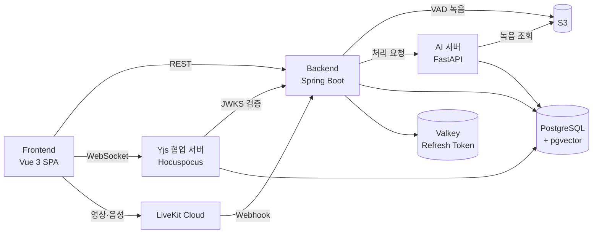

# CoMeetTool

팀 스페이스 안에서 화상회의를 하고, 회의 중에 문서를 함께 고치고, 회의가 끝나면 AI가 전사·요약·진행 피드백을 만들어 주는 회의 협업 도구입니다.

- **기간**: 2026.07.14 – 08.10 (27일)
- **팀**: 7명 · SSAFY 교육 과정 공통 프로젝트
- **상태**: 개발 종료, 운영하지 않음 (아래 [운영 상태](#운영-상태))

## 주요 기능

| 영역 | 내용 |
| --- | --- |
| 계정 | 회원가입·로그인(RS256 JWT, Access/Refresh Token), 최초 온보딩 |
| 팀 스페이스 | 생성·멤버 초대와 수락, OWNER·MEMBER·GUEST 권한, 팀 일정 캘린더 |
| 화상회의 | LiveKit 기반 영상·음성·채팅·화면 공유. 회의를 유지한 채 PiP로 문서 화면으로 이동 |
| 공유 문서 | Tiptap + Yjs(CRDT) + Hocuspocus 실시간 공동 편집, 사용자별 커서 표시 |
| 발화 녹음 | 브라우저에서 VAD로 발화 구간만 잘라 업로드 → S3 저장 |
| AI 산출물 | 회의 종료 후 비동기 처리. 회의 전문(STT) · AI 요약(검토·수정·최종 확정) · AI 피드백(참여도·의사결정·다음 회의 제안) |
| 내보내기 | 요약·피드백을 MD/PDF로 내보내기(Presigned URL) |

시연 흐름은 [exec/DEMONSTRATION_SCENARIO.md](exec/DEMONSTRATION_SCENARIO.md)에 화면 단위로 적혀 있습니다.

## 구성



AI 서버는 faster-whisper로 전사한 뒤, 과거 회의록을 pgvector로 찾아 맥락에 넣고 LLM으로 회의록과 퍼실리테이터 보고서를 구조화해 저장합니다.

## 기술 스택

| 영역 | 기술 |
| --- | --- |
| Backend | Java 21 · Spring Boot 4.1 · Spring Data JPA · Spring Security · PostgreSQL 17 · Valkey(Redis) |
| 실시간 협업 | Node.js 22 · Hocuspocus 4 · Yjs |
| AI | Python 3.11 · FastAPI · faster-whisper · OpenAI 호환 API(SSAFY GMS) · pgvector |
| Frontend | Vue 3 · Vite · Tiptap · livekit-client · Vitest |
| 미디어 | LiveKit Cloud |
| 인프라 | AWS ECS Fargate · RDS · ElastiCache · S3 · CloudFront · GitLab CI/CD(OIDC) |

버전 상세는 [exec/PORTING_MANUAL.md §4](exec/PORTING_MANUAL.md#4-사용-기술과-버전)에 있습니다.

## 폴더 구조

```text
.
├── Main/
│   ├── Backend/        Spring Boot API 서버 (auth·space·schedule·meeting·document·report…) + Flyway SQL
│   ├── Backend-Yjs/    Hocuspocus/Yjs 협업 서버
│   ├── AI_BE/          FastAPI 전사·회의 분석 서버
│   ├── Frontend/       Vue/Vite SPA
│   └── Docs/
│       ├── 00_Convention/  Git·코드·API 컨벤션
│       ├── 01_Plan/        기능 명세·아키텍처·DB 스키마·구현 계획
│       ├── 02_Dailylog/
│       └── 03_API/         인증 계약·REST 명세
├── exec/               포팅 매뉴얼·외부 서비스 설정·시연 시나리오·DB 스키마 덤프
├── .gitlab/            CI 스크립트·이슈/MR 템플릿
└── .gitlab-ci.yml
```

## 실행 방법

서버 네 개(Backend · Yjs · AI · Frontend)와 PostgreSQL(pgvector)·Valkey가 필요합니다. 저장소에 Docker Compose 파일은 없습니다.

| 문서 | 내용 |
| --- | --- |
| [exec/PORTING_MANUAL.md](exec/PORTING_MANUAL.md) | 로컬 통합 실행 순서(§12), 서비스별 환경변수, Docker 이미지 빌드, 배포 절차 |
| [exec/EXTERNAL_SERVICES.md](exec/EXTERNAL_SERVICES.md) | AWS·LiveKit·SSAFY GMS 등 외부 서비스 계정과 키 준비 |
| [exec/database/README.md](exec/database/README.md) | 스키마 덤프로 로컬 DB 만들기 |

각 서버의 `.env.example`을 `.env`로 복사해 값을 채웁니다. 기본 포트는 Frontend 5173 · Backend 8080 · Yjs 3000 · AI 8000입니다.

매뉴얼은 GitLab에서 쓰던 그대로라 몇 가지를 바꿔 읽어야 합니다.

- 클론 주소와 폴더 이름은 `https://github.com/DreamingGenie/Comeettool.git` · `Comeettool`로 바꿉니다.
- AI 분석은 SSAFY GMS 키를 전제로 합니다. GMS 주소가 `Main/AI_BE/app/pipeline/` 아래 네 곳에 `base_url`로 고정돼 있어, 교육 과정 밖에서 AI 산출물까지 재현하려면 이 값을 다른 OpenAI 호환 엔드포인트로 바꿔야 합니다.
- 배포 파이프라인(`.gitlab-ci.yml`)은 GitLab Runner와 AWS 계정을 전제로 하며 GitHub에서는 동작하지 않습니다.

## 내 역할 — 전진 (DreamingGenie)

팀 합의로 PM 겸 통합 담당을 맡아 MR 리뷰와 develop 통합을 담당했습니다.

- develop에 합친 머지 109건 중 86건을 처리했습니다. 그중 66건이 팀원 브랜치입니다. 제 브랜치 9건은 팀원이 머지했습니다.
- main 머지 10건은 모두 제가 했고, 그중 배포가 9건입니다.
- 기본 브랜치를 main에서 develop으로 바꾸고, 팀이 합의한 규칙을 컨벤션 문서로 정리했습니다([Main/Docs/00_Convention](Main/Docs/00_Convention)).
- 공통 응답·예외 처리 틀(`f66a04f`)을 만들었고, 팀원 4명이 각자 기능의 에러 코드를 여기에 더해 썼습니다.
- 팀 스페이스·일정 백엔드 API 13개와 그 테스트를 만들었습니다. 두 기능의 API 중 대표 이미지 변경 1개는 팀원이 만들었고, 저는 거기에 검증과 테스트를 보탰습니다.

화상회의, 실시간 문서 편집, VAD, AI 분석, CI/CD는 팀원들이 만들었습니다. 저는 그 코드를 리뷰하고 통합했고, 구현에 깊이 관여하지는 않았습니다.

> 머지 건수는 프로젝트 마지막 배포 커밋 `f17f3f4`(2026-08-10) 기준입니다.

## 저장소 이력

- SSAFY GitLab에서 개발했고, 2026-10-06 GitHub로 옮겨 공개했습니다.
- 공개하면서 서비스와 관계없는 교육 과정 개인 실습 폴더를 이력에서 지웠습니다. 그래서 커밋 해시가 GitLab 원본과 다릅니다.
- 커밋 메시지와 문서의 `S15P11A707-123` 같은 키는 Jira 이슈, `!83` 같은 번호는 GitLab MR입니다. 둘 다 교육 과정 계정으로만 열리는 곳이라 링크가 열리지 않습니다.
- GitHub에는 `main`(배포)과 `develop`(통합) 두 브랜치만 있습니다.

## 운영 상태

교육 과정이 끝나 서비스를 운영하지 않습니다. 2026-10-18 확인 기준 API 도메인이 응답하지 않아, 배포 주소로는 기능을 쓸 수 없습니다.
